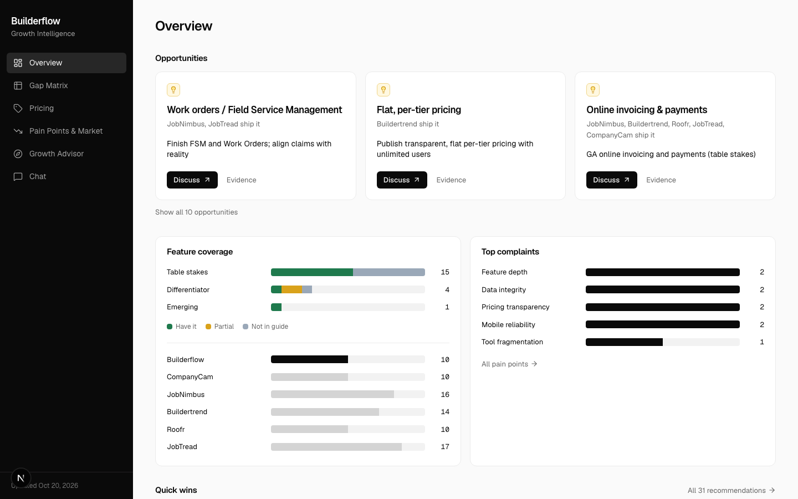
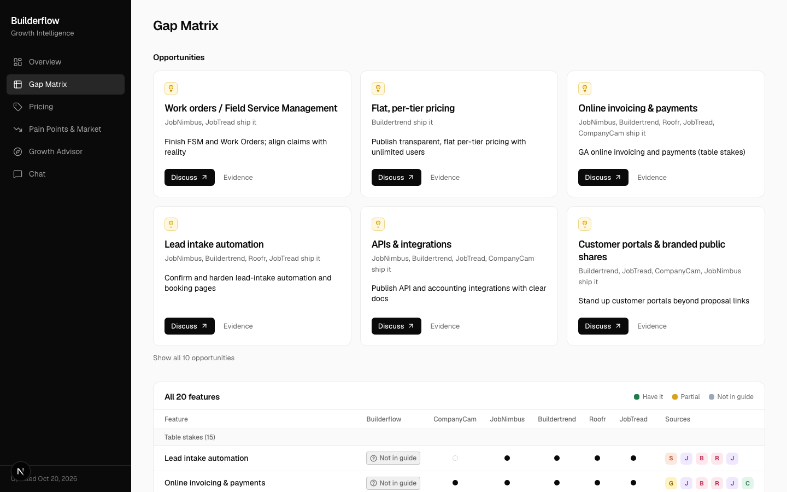
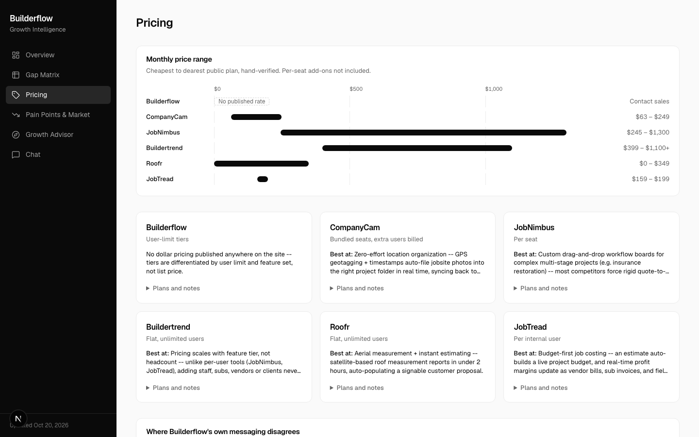
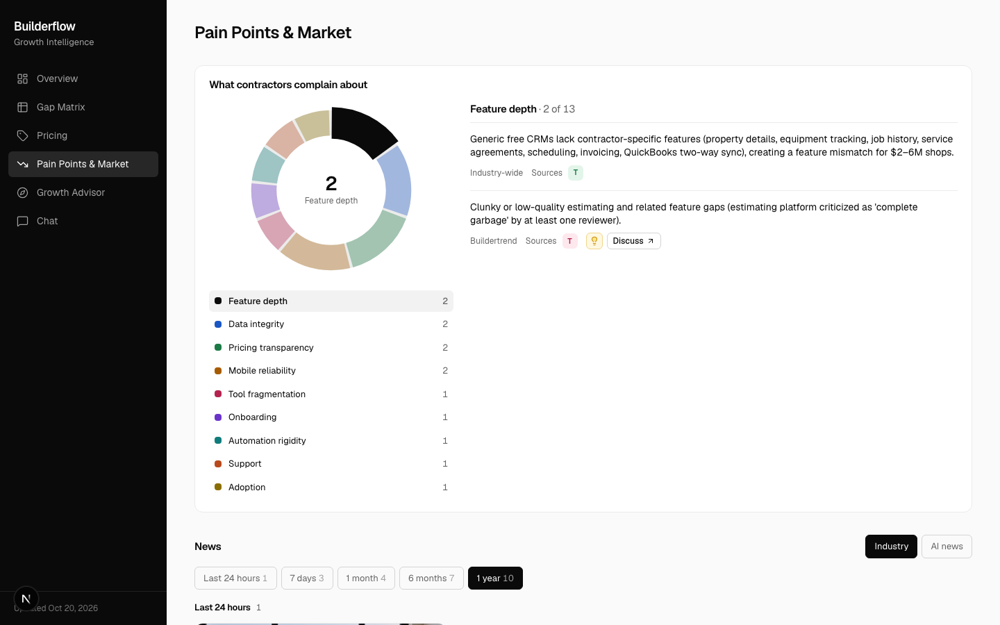
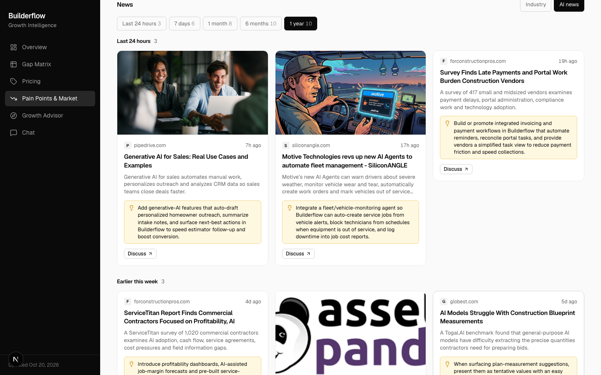
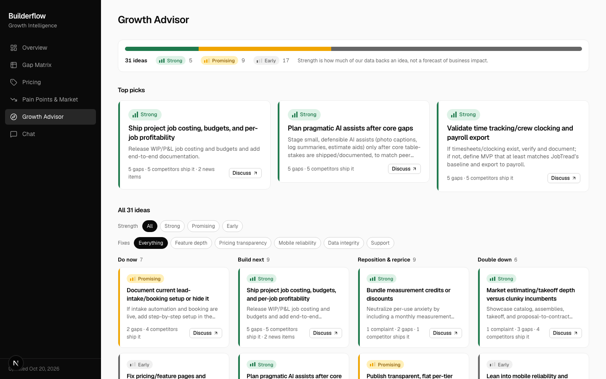
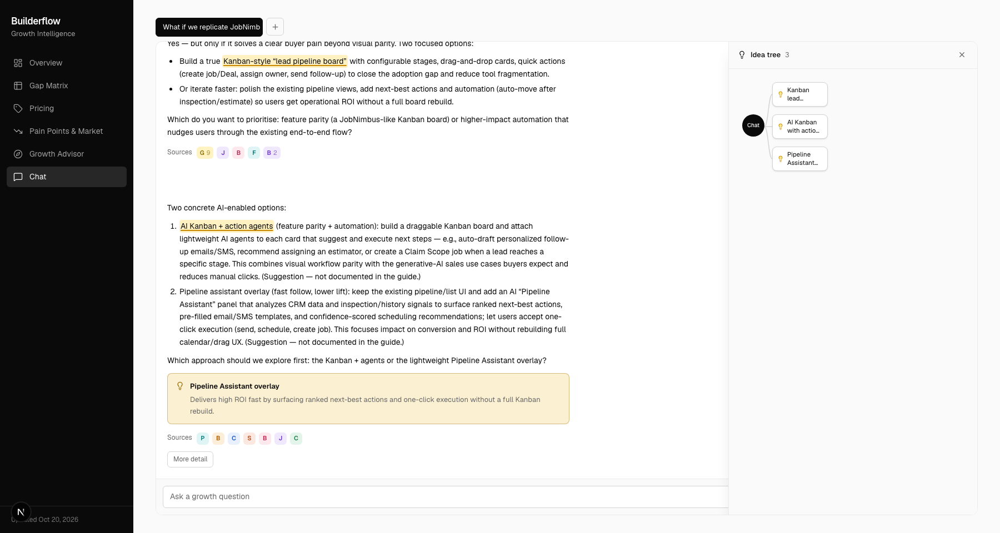
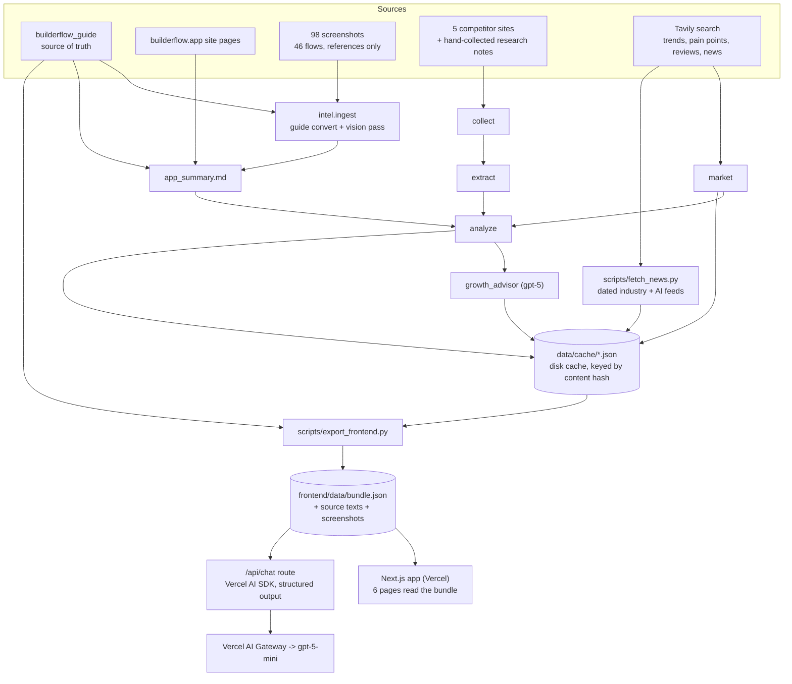

# Builderflow Growth Intelligence Tool

**Live demo: https://builderflow-intel.vercel.app**



## Why this exists

This was an open-ended assessment: "build something useful for Builderflow." No external
brief, so this is the idea I chose.

[Builderflow](https://builderflow.app) (by SNS System Inc.) pitches itself as lead
management and CRM for remodelers and contractors ("Stop Losing Leads, Start Booking More
Jobs") and lists 7 modules on its website: Lead Intake Automation, Estimate Pro, Claim
Scope, FSM, Finance, Work Orders, Technician Mobile App. But the product portal
(portal.builderflow.app) says only Claim Scope is actually live, with CRM, estimates and
finance "rolling out next." Builderflow has little internal data and no systematic view of
what bigger competitors offer, what contractors complain about, or where the market is
heading — product decisions are guesswork.

So this tool builds that view: it reads Builderflow's own guide/website/screenshots,
scrapes and extracts structured profiles from 5 competitors (CompanyCam, JobNimbus,
Buildertrend, Roofr, JobTread), pulls market trends, contractor pain points and dated industry + AI news from
live search, and turns all of it into a feature gap matrix, pricing comparison,
messaging-inconsistency flags, and a prioritized growth-advisor recommendation list — every
claim backed by a citation back to its source. Plus a chat assistant that brainstorms with you
over everything the pipeline produced, with the same citation discipline, and turns the ideas
you reach into a tree.

A reliable demo running entirely on cached data beats a perfect live scraper — that's the
design bias throughout.

## The app

Six pages, black-and-white, built to be read at a glance. Every card, row and idea links to its
evidence, shown as source chips that reveal the real URL, guide section or screenshot on hover.

| | |
|---|---|
| **Overview** — opportunities first (each gap is an opportunity), feature coverage, top complaints, quick wins. | **Gap Matrix** — Builderflow vs five competitors, graded by source strength, with an idea card above each gap. |
|  |  |
| **Pricing** — hand-verified public price ranges for six companies, plus plan tables. | **Pain Points & Market** — complaint themes as an interactive donut, then dated news. |
|  |  |
| **News** — Industry and AI feeds, grouped by age (24 hours to 1 year). AI stories carry a "how Builderflow could use it" note and a Discuss button. | **Growth Advisor** — best-supported ideas, an action board and a complaint-theme filter. |
|  | |

### Chat as a brainstorming partner



- Streams short replies by default and goes long when asked, rendered as Markdown.
- Answers from the whole analysis, the dated news and the **full user guide** (about 25k tokens
  per question, sent whole rather than searched), and cites its sources as chips.
- Every reply is a fixed JSON object (`answer`, `sources`, `ideas`) validated by a Zod schema,
  so ids and tags can never leak into the text.
- When the conversation lands on a strong idea, the model records it. The phrase is highlighted
  inline, and the **Ideas** drawer shows the idea tree: building on an idea adds a child,
  alternatives become siblings, and hovering a node shows its reasoning.
- Up to three chats in tabs, saved in your browser.

## Architecture



**Two halves, one file between them.** The Python side (`intel/`, `scripts/`) does all the
slow, paid work (scraping, search, LLM calls) and caches every step to `data/cache/`. The
Next.js side never calls those services: page loads read one exported `bundle.json`, so the
site is fast and costs nothing to browse. The only live model call is the chat route.

**The pipeline is a plain cached function chain, not a LangGraph graph.** LangGraph was in
the original stack plan, but the actual pipeline has no branching or fan-out — it's a
straight sequence (`growth_advisor` calls `analyze`, which calls `market` and
`collect`+`extract`), and `intel/cache.py` already makes every fetch and every LLM call
idempotent and free on re-run. A graph framework would add indirection without adding
capability here, so it was cut; `langgraph` isn't in requirements.txt. `intel/graph.py` is
the real single entrypoint (`python -m intel.graph`).

**The chat sends everything instead of searching.** The original Python chat used a Chroma
vector index (still in `intel/rag.py`). The whole analysis plus the guide is only about 25k
tokens, so the web chat sends it on every question: no retrieval misses, and answers can cite
any guide section. It costs roughly a cent per message on gpt-5-mini.

## Design choices worth knowing about

- **Citation-by-id, not citation-by-retype.** Early on, asking an LLM to copy a citation's
  exact `ref` (a screenshot path with spaces, a long URL) verbatim was unreliable — ~40% of
  screenshot refs came back as paraphrased labels instead of real, openable paths. Every
  node that needs a model to "point at" evidence instead of re-deriving it now assigns every
  citation a short id (`C1`, `C2`, ...) via `intel/citations.py`, has the model reference
  only ids, and resolves ids back to real `Citation` objects in Python. `growth_advisor.py`
  and `intel/rag.py`'s chat both use this.
- **Tiers and theme clusters are computed deterministically, not left to the model.**
  Gap-matrix tiering (`table_stakes` / `differentiator` / `emerging`) is a counting rule —
  how many of the 5 competitors have a feature — so it's recomputed in Python after the LLM call
  rather than trusted per-row, where it drifted inconsistent across a long list. Pain-point
  themes use a closed `Literal` vocabulary (11 fixed tags) instead of open-ended "reuse a
  tag" instructions, which produced 13 unique one-off tags for 13 pain points the first time.
- **Messaging-inconsistency citations point at real, fetchable pages** (the homepage and
  pricing page's actual frontmatter URLs), not at the tool's own derived `app_summary` —
  citing your own synthesis as a source isn't a citation.
- **Marketing pages alone are weak signal.** A raw "do they have feature X" scrape overstates
  parity. The gap matrix tiers every row by how many competitors actually have it and grounds
  Builderflow's own status only in the guide + screenshots, not the website's own marketing
  copy, since Builderflow's website/portal/guide already disagree with each other.
- **Gap status is graded by source strength, with the guide as truth.** Screenshots came from a
  brand-new empty account, so an empty screen or an "add" button proves nothing; the website
  and portal never override the guide. See "How Builderflow status is decided" below.
- **The chat output is a schema, not prose to be cleaned up.** An earlier version asked the
  model to append tags and ids to its text, then stripped them with regexes; they leaked. The
  reply is now structured output, rendered field by field.
- **News filters stored items.** Each news item keeps its published date, so the 24h / 7d /
  1m / 6m / 1y filter is a client-side filter, not an API call per click.

## Repo layout

```
app.py                      Streamlit app (the original UI; still works, no longer the main one)
intel/                      the pipeline (plain cached function chain)
  graph.py                  entrypoint:  python -m intel.graph
  ingest.py, guide.py,      Builderflow ingestion: guide -> markdown, vision pass, app_summary
    vision.py, summary.py
  nodes/                    collect, extract, market, analyze, growth_advisor
  rag.py, citations.py      Chroma index for the Streamlit chat; citation-by-id helper
  cache.py, schemas.py      disk cache keyed by content hash; Pydantic models
scripts/
  fetch_news.py             dated industry + AI news (Tavily) -> data/cache/news.json
  export_frontend.py        cache -> frontend/data/bundle.json, source texts, screenshots
  chat_api.py               FastAPI shim over the Python chat (no longer used by the frontend)
frontend/                   Next.js 16 + Tailwind 4, hand-built components
  app/                      pages + app/api/chat (streaming route, rate limit)
  components/, lib/         UI, idea tree, evidence/idea matching, chat context
data/
  builderflow_guide.docx    user guide (primary source, private -- gitignored)
  builderflow_site/         public website text, by page
  builderflow_screens/      98 screenshots across 46 flows (private -- gitignored)
  competitors.yaml, manual/ competitor URLs; hand-verified pricing and fallback text
  cache/                    every fetch and LLM output (gitignored)
docs/screenshots/           images used in this README
```

## Setup

```bash
python -m venv .venv && source .venv/bin/activate
pip install -r requirements.txt
playwright install chromium
```

`.env` needs `OPENAI_API_KEY` and `TAVILY_API_KEY` (never committed).

## Running it

**1. Build the data** (needs API keys; every step is cached, so re-runs are free):
```bash
python -m intel.ingest         # guide conversion + vision pass + app_summary (one-time)
python -m intel.graph          # collect -> extract -> market -> analyze -> growth_advisor
python scripts/fetch_news.py   # dated industry + AI news
python scripts/export_frontend.py   # cache -> frontend/data/bundle.json (+ source texts, screenshots)
```

**2. Run the web app locally:**
```bash
cd frontend && npm install
echo "OPENAI_API_KEY=..." > .env.local     # or AI_GATEWAY_API_KEY=... for Vercel's AI Gateway
npm run dev                                 # http://localhost:3000
```
`frontend/data/` (the bundle and source texts) and the copied screenshots are gitignored: they
derive from the cache and from private material, so re-run the export after cloning or after any
data refresh.

**3. Deploy to Vercel** (from `frontend/`; `.vercelignore` makes the CLI upload the gitignored
data folder):
```bash
npx vercel login
npx vercel link --yes --project builderflow-intel
npx vercel deploy --prod --yes
```
On Vercel the chat goes through the AI Gateway, authenticated by the platform's own token (a card
on the Vercel account unlocks the free credits). Elsewhere it uses `OPENAI_API_KEY`. The chat route
caps each visitor at 30 messages an hour, best-effort per server instance; set a spend limit at the
provider as the hard stop. To publish new data: run steps 1, then `vercel deploy --prod` again.

**Old Streamlit UI** (reads the same cache): `python -m intel.rag && streamlit run app.py`.

### How "Builderflow status" is decided
The user guide is the source of truth; screenshots only illustrate it (they came from a
brand-new account, so an empty screen or an "add" button says nothing about completeness) and
the website/portal never override it. **Have it** = the guide explains that exact capability;
**partial** = the guide itself says coming soon / limited; **not in guide** = only the website or
screenshots show it; **not found** = no source mentions it. The whole guide is fed to the
summary and gap-matrix steps, and each guide-backed row cites a real guide section heading. None
of it was tested in a running product.

## What's in the data

- **Builderflow**: the user guide, website pages and 98 screenshots across 46 flows, condensed into
  one `app_summary.md` that grounds every downstream node.
- **Competitors**: CompanyCam, JobNimbus, Buildertrend, Roofr and JobTread — homepage, pricing,
  features and changelog scraped and cached by URL, plus hand-collected research notes
  (`data/manual/<name>.md`, from `data/competition.txt`) added to each profile.
- **Pricing is hand-verified, not LLM-extracted** — `data/manual/competitor_pricing.yaml` covers
  Builderflow, CompanyCam, JobNimbus, Buildertrend, Roofr and JobTread. Exact prices need to be
  exact, so the Pricing page renders that file directly and the pricing comparison is built from it
  in Python.
- **Market**: industry trends, 13 themed contractor pain points and review snippets from
  Tavily search, cached by query.
- **News**: 20 dated stories (10 industry, 10 AI), refreshed on demand with `fetch_news.py`.
- **Analysis**: 20 gap-matrix rows (10 have it, 2 partial, 8 not in guide), pricing comparisons and
  messaging inconsistencies.
- **Growth advice**: 31 recommendations across build / double down / positioning / pricing / quick
  win, each citation-backed and traceable to the gap row, pain point, pricing row or messaging flag
  behind it.

## Known limits

- Relevance links between news, pain points, gaps and ideas are keyword heuristics, not model
  judgments, so a match can be loose.
- The chat has no live web search (the old Python chat did) and no saved history beyond the
  browser's local storage; only the last 12 messages are sent each turn.
- Two news sites block image fetching, so those cards show text only.
- Not done: a flow map of Builderflow's own UI, more competitors (Encircle, AccuLynx, DASH), and a
  screenshot fallback in chat.
- The chat does not refuse off-topic questions; it is a growth-advisor demo, not a hardened product.

## Conventions

- Every fetch and every LLM call is disk-cached (`data/cache/`) by content hash — re-runs
  cost nothing.
- Every insight carries real source URLs, chunk ids, guide sections or screenshot paths.
- "Not found in our data," never "Builderflow lacks X" — the tool doesn't invent absence.
- `.env` and `data/cache/` are never committed; `data/builderflow_screens/` and the guide
  are gitignored since they're private company material.
