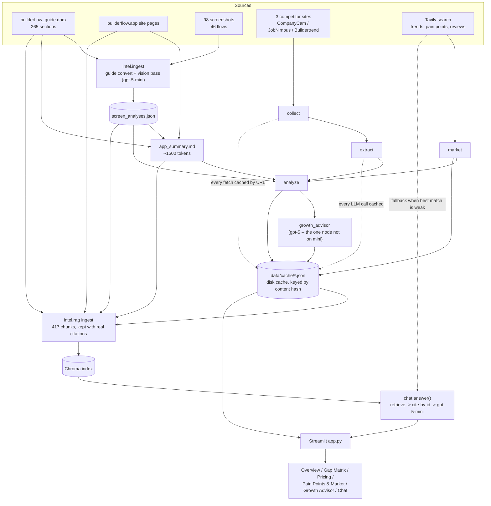

# Builderflow Growth Intelligence Tool

## Why this exists

This was an open-ended assessment: "build something useful for Builderflow." No external
brief, so this is the idea I chose.

[Builderflow](https://builderflow.app) (by SNS System Inc.) pitches itself as lead
management and CRM for remodelers and contractors ("Stop Losing Leads, Start Booking More
Jobs") and lists 7 modules on its website: Lead Intake Automation, Estimate Pro, Claim
Scope, FSM, Finance, Work Orders, Technician Mobile App. But the product portal
(portal.builderflow.app) says only Claim Scope is actually live, with CRM, estimates and
finance "rolling out next." Builderflow has little internal data and no systematic view of
what bigger competitors offer, what contractors complain about, or where the market is
heading — product decisions are guesswork.

So this tool builds that view: it reads Builderflow's own guide/website/screenshots,
scrapes and extracts structured profiles from 3 competitors (CompanyCam, JobNimbus,
Buildertrend), pulls market trends and contractor pain points from live search, and turns
all of it into a feature gap matrix, pricing comparison, messaging-inconsistency flags, and
a prioritized growth-advisor recommendation list — every claim backed by a citation back to
its source. Plus a chat assistant that answers ad-hoc growth questions over everything the
pipeline has produced, with the same citation discipline.

A reliable demo running entirely on cached data beats a perfect live scraper — that's the
design bias throughout.

## Architecture



**The pipeline is a plain cached function chain, not a LangGraph graph.** LangGraph was in
the original stack plan, but the actual pipeline has no branching or fan-out — it's a
straight sequence (`growth_advisor` calls `analyze`, which calls `market` and
`collect`+`extract`), and `intel/cache.py` already makes every fetch and every LLM call
idempotent and free on re-run. A graph framework would add indirection without adding
capability here, so it was cut; `langgraph` isn't in requirements.txt. `intel/graph.py` is
the real single entrypoint (`python -m intel.graph`).

## Design choices worth knowing about

- **Citation-by-id, not citation-by-retype.** Early on, asking an LLM to copy a citation's
  exact `ref` (a screenshot path with spaces, a long URL) verbatim was unreliable — ~40% of
  screenshot refs came back as paraphrased labels instead of real, openable paths. Every
  node that needs a model to "point at" evidence instead of re-deriving it now assigns every
  citation a short id (`C1`, `C2`, ...) via `intel/citations.py`, has the model reference
  only ids, and resolves ids back to real `Citation` objects in Python. `growth_advisor.py`
  and `intel/rag.py`'s chat both use this.
- **Tiers and theme clusters are computed deterministically, not left to the model.**
  Gap-matrix tiering (`table_stakes` / `differentiator` / `emerging`) is a counting rule —
  how many of 3 competitors have a feature — so it's recomputed in Python after the LLM call
  rather than trusted per-row, where it drifted inconsistent across a long list. Pain-point
  themes use a closed `Literal` vocabulary (11 fixed tags) instead of open-ended "reuse a
  tag" instructions, which produced 13 unique one-off tags for 13 pain points the first time.
- **Messaging-inconsistency citations point at real, fetchable pages** (the homepage and
  pricing page's actual frontmatter URLs), not at the tool's own derived `app_summary` —
  citing your own synthesis as a source isn't a citation.
- **Marketing pages alone are weak signal.** A raw "do they have feature X" scrape overstates
  parity. The gap matrix tiers every row by how many competitors actually have it and grounds
  Builderflow's own status only in the guide + screenshots, not the website's own marketing
  copy, since Builderflow's website/portal/guide already disagree with each other.

## Repo layout

```
app.py                      Streamlit entry, 6 tabs, reads only cached JSON -- no LLM calls from the UI
intel/
  graph.py                  pipeline entrypoint (plain function chain)
  ingest.py                 Builderflow ingestion entrypoint (guide convert -> vision -> app_summary)
  guide.py                  docx -> markdown, preserving heading hierarchy
  vision.py                 screenshot vision pass (gpt-5-mini, cached by image hash)
  modules.py                maps screenshot folders to guide modules
  summary.py                builds app_summary.md
  rag.py                    Chroma ingest + retrieval + chat answer()
  citations.py              shared citation-by-id mechanism
  cache.py                  disk cache keyed by content hash
  schemas.py                every structured LLM output, as Pydantic models
  nodes/
    collect.py               competitor page fetch (Playwright), cached by URL
    extract.py                features/pricing/positioning extraction
    market.py                 industry trends, pain points, review snippets (Tavily)
    analyze.py                gap matrix, pricing comparison, messaging inconsistencies
    growth_advisor.py         prioritized recommendations (gpt-5)
data/
  builderflow_guide.docx     user guide (primary source, private -- gitignored)
  builderflow_site/          public website text, by page
  builderflow_screens/       98 screenshots across 46 flows (private -- gitignored)
  competitors.yaml           competitor names + homepage URLs
  manual/                    hand-pasted fallback text for blocked sites
  cache/                     every fetch + every LLM output + the Chroma index (gitignored)
```

## Setup

```bash
python -m venv .venv && source .venv/bin/activate
pip install -r requirements.txt
playwright install chromium
```

`.env` needs `OPENAI_API_KEY` and `TAVILY_API_KEY` (never committed).

## Running it

**From scratch** (needs API keys, does real work):
```bash
python -m intel.ingest    # guide conversion + vision pass + app_summary (one-time, ~98 cached vision calls)
python -m intel.graph     # collect -> extract -> market -> analyze -> growth_advisor
python -m intel.rag       # build the Chroma chat index
streamlit run app.py
```

**Offline demo, entirely on cached data** (the point of the caching discipline: this costs
$0 and makes 0 network calls once `data/cache/` is populated):
```bash
source .venv/bin/activate
python -m intel.graph
```
```
gap_matrix=16 pricing_comparison=3 top_pain_points=8 messaging_inconsistencies=4 growth_recommendations=20
```
*(Row counts can shift slightly between regenerations -- gap-matrix synthesis and pain-point
selection involve LLM judgment calls, e.g. how finely to split two similar features into one
row vs two. Counts are illustrative, not a contract.)*
*(The "fetching.../searching..." lines you'll see are `intel/cache.py` cache lookups, not
live network calls -- every one of them is a hit once the cache is warm.)*

```bash
streamlit run app.py
```
Opens all 6 tabs against the cached pipeline output. The Chat tab needs the Chroma index
built once (`python -m intel.rag`, 417 chunks, also idempotent/cached) but asks no new
questions of the LLM until you actually type one.

## What's in the data

- **Builderflow**: 265 guide sections, 10 website pages, 98 screenshots across 46 flows → one
  ~1500-token `app_summary.md` that grounds every downstream node.
- **Competitors**: CompanyCam, JobNimbus, Buildertrend — homepage, pricing, features,
  changelog, each cached by URL (feeds the gap matrix / growth advisor / chat).
- **Pricing tab specifically** uses hand-verified pricing for Builderflow, JobNimbus,
  CompanyCam, Roofr and JobTread (`data/manual/competitor_pricing.yaml`, sourced from
  `data/competition.txt` + Builderflow's own pricing page) instead of LLM-extracted dollar
  figures — exact prices need to be exact, not inferred from a scrape. AI still covers
  features, positioning, and messaging-inconsistency analysis.
- **Market**: 6 industry trends, 16 themed contractor pain points, 10 review snippets, all
  via live Tavily search, cached by query.
- **Analysis**: ~16 gap-matrix rows, 3 pricing comparisons, 8 selected top pain points, ~4
  messaging inconsistencies.
- **Growth advice**: ~20 recommendations across build / double-down / positioning / pricing /
  quick-win, every one citation-backed and now also traceable to the specific gap-matrix row,
  pain point, pricing row, or messaging flag that justified it (`evidence` field, surfaced in
  the Growth Advisor tab).
- **Chat index**: 417 chunks across all of the above.

## What's not done (cut for time, not forgotten)

- Flow map / Mermaid diagrams of Builderflow's own UI flows (optional extra, CLAUDE.md).
- More competitors beyond the 3 (Encircle, AccuLynx, DASH, JobTread were optional).
- Chat screenshot fallback (re-querying a single linked screenshot inline in chat).
- Chat doesn't hard-refuse off-topic questions — if retrieval is weak it falls back to a
  live web search and will answer genuinely unrelated questions too, using whatever that
  search finds. Fine for a growth-advisor demo; would need an explicit scope check for
  production.

## Conventions

- Every fetch and every LLM call is disk-cached (`data/cache/`) by content hash — re-runs
  cost nothing.
- Every insight carries real source URLs, chunk ids, or screenshot paths, verified to
  actually resolve (checked programmatically during development, not just eyeballed).
- "Not found in our data," never "Builderflow lacks X" — the tool doesn't invent absence.
- `.env` and `data/cache/` are never committed; `data/builderflow_screens/` and the guide
  are gitignored since they're private company material.
